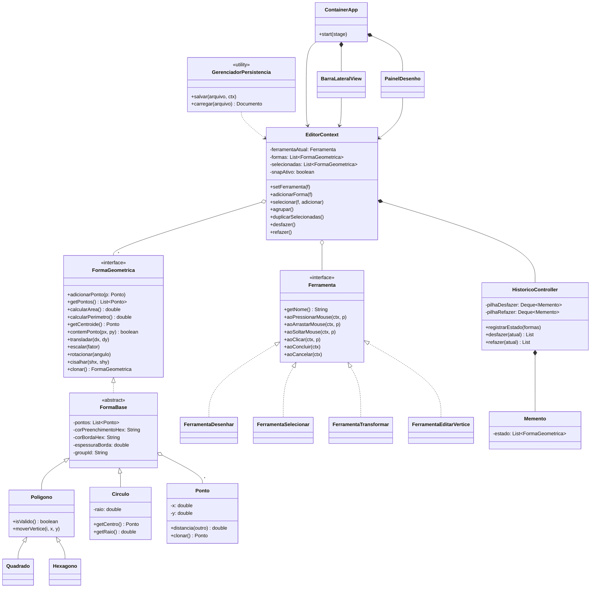

# Editor de Desenho Vetorial Interativo (JavaFX)

Trabalho N3 — Programação Orientada a Objetos 1 (UniRV, Engenharia de Software, 2026/1).

Editor desktop para criar, editar e salvar formas geométricas 2D sobre um canvas interativo, aplicando os padrões GoF **State**, **Command/Memento** (Undo/Redo), **Prototype** e **Composite**, com separação em camadas **Models / Controller / Views**.

## Requisitos atendidos

| ID   | Requisito                                   | Como foi atendido |
|------|---------------------------------------------|-------------------|
| RT01 | Java 17 LTS ou superior                     | `maven.compiler.release` = 17 |
| RT02 | JavaFX 17+ com código programático          | JavaFX 21.0.5 (`javafx-controls`) |
| RT03 | Apache Maven                                | `pom.xml` |
| RT04 | Persistência XML/JSON/serialização          | XML com a API DOM da JDK (`GerenciadorPersistencia`) |
| RT05 | Patterns State, Prototype e Memento         | ver seção abaixo |
| RT06 | Camadas Models, Controller e Views          | pacotes `org.example.Models`, `org.example.Controller`, `org.example.Views` |

## Como executar

Pré-requisitos: JDK 17+ e Maven 3.8+.

```bash
mvn test
```

```bash
mvn javafx:run
```

## Funcionalidades

- **Criação dinâmica**: polígonos por cliques (concluir com `Enter`, clique direito ou duplo clique); círculos, quadrados e hexágonos por arrasto.
- **Snap to grid**: coordenadas são arredondadas para a grade configurável (checkbox na barra lateral).
- **Seleção visual**: formas selecionadas são destacadas com contorno tracejado e alças nos vértices.
- **Transformações**: translação, escala, rotação e cisalhamento por arrasto, em torno do centroide.
- **Edição de vértices**: arraste um vértice de um polígono selecionado.
- **Grupos (Composite)**: `Ctrl+G` agrupa a seleção, `Ctrl+Shift+G` desagrupa. Um grupo é transformado e selecionado como uma única forma.
- **Camadas**: lista na barra lateral; reordenação com “Trazer p/ frente” e “Enviar p/ trás”.
- **Duplicar (Prototype)**: cria cópias profundas das formas selecionadas, deslocadas.
- **Undo/Redo**: `Ctrl+Z` / `Ctrl+Y`.
- **Barra de status**: coordenadas do cursor, total de formas, área e perímetro da seleção.
- **Persistência**: `Ctrl+S` / `Ctrl+O` / `Ctrl+N`, em arquivos `.xml`.
- **Robustez**: arquivos corrompidos ou com geometria inválida mostram um alerta explicativo e o desenho atual é mantido. Ao fechar ou abrir outro arquivo com alterações pendentes, o editor pergunta se deseja salvar.

## Atalhos

| Atalho | Ação |
|--------|------|
| `Ctrl+N` / `Ctrl+O` / `Ctrl+S` | Novo / Abrir / Salvar |
| `Ctrl+Z` / `Ctrl+Y` | Desfazer / Refazer |
| `Delete` | Excluir seleção |
| `Ctrl+G` / `Ctrl+Shift+G` | Agrupar / Desagrupar |
| `Shift` + clique | Adicionar à seleção |
| `Enter` | Concluir polígono |
| `Esc` | Cancelar construção em andamento |

## Arquitetura

```
org.example.Models       FormaGeometrica (interface), FormaBase, Ponto, Poligono, Circulo, Quadrado, Hexagono
org.example.Controller   EditorContext, Ferramenta (State), FerramentaDesenhar, FerramentaSelecionar,
                         FerramentaTransformar, FerramentaEditarVertice, HistoricoController (Memento),
                         GerenciadorPersistencia, PersistenciaException
org.example.Views        ContainerApp (Application, main), BarraLateralView, PainelDesenho
```

### Padrões de projeto

- **State** — `Ferramenta` é a interface de estado; `EditorContext` é o contexto e delega `aoPressionarMouse`, `aoArrastarMouse`, `aoSoltarMouse` e `aoClicar` à ferramenta ativa. Cada ferramenta concreta muda o comportamento do canvas sem condicionais no contexto.
- **Memento / Undo-Redo** — `HistoricoController` mantém duas pilhas (desfazer/refazer) de `Memento`s. `registrarEstado` salva **cópias profundas** das formas (via `clonar()`), então alterações posteriores não afetam o histórico.
- **Prototype** — `FormaGeometrica.clonar()` retorna uma cópia independente (pontos, cores, grupo). É usado pelo histórico e pela função Duplicar.
- **Composite** — formas com o mesmo `groupId` se comportam como uma única forma lógica: seleção, translação, escala, rotação e cisalhamento operam sobre o grupo inteiro, em torno do centroide do conjunto.

### Regras de negócio (pacote `Models`)

- `Poligono`: mínimo de 3 pontos. Área pela fórmula de Gauss (shoelace); perímetro como soma das distâncias entre vértices consecutivos.
- `Circulo`: raio estritamente positivo (`r > 0`). Área `πr²`, perímetro `2πr`.
- `Quadrado` e `Hexagono`: vértices calculados automaticamente a partir do canto/centro e do lado/raio.
- Transformações: translação soma `dx, dy`; escala multiplica a distância ao centroide pelo fator; rotação gira em torno do centroide por um ângulo em radianos.

### Diagrama de classes (UML)



## Formato do arquivo

```xml
<desenho versao="1" largura="800.0" altura="600.0" grade="20.0" snap="false">
  <forma tipo="POLIGONO" corPreenchimento="#4A90E2" corBorda="#1F2937" espessura="1.0" grupo="...">
    <ponto x="0.0" y="0.0"/>
    ...
  </forma>
  <forma tipo="CIRCULO" ... raio="12.5">
    <ponto x="50.0" y="50.0"/>
  </forma>
</desenho>
```

## Testes

`src/test/java` contém 19 testes JUnit 5 cobrindo: área/perímetro (Gauss), validações (mín. 3 pontos, raio > 0), transformações e centroide, cópia profunda do Prototype, Undo/Redo, grupos, snap à grade, ida e volta da persistência e leitura de arquivos corrompidos ou inválidos.

```bash
mvn test
```
